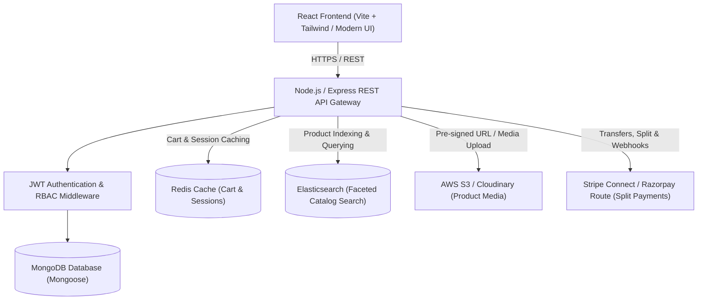

# Multi-Vendor E-Commerce Marketplace — Implementation Plan & Architecture

> **Project Code:** FS-01 | **Track:** Full-Stack Development  
> **Estimated Effort:** 14 Days | **Deadline:** 20 November 2026

---

## 1. System Architecture

---

## 2. Role-Based Access Control (RBAC)

1. **Customer**:
   - Register, login, manage profile & addresses.
   - Search catalog with Elasticsearch (instant keyword match, price & category facets).
   - Redis-backed shopping cart.
   - Checkout with multi-vendor split payment.
   - Track order lifecycle (`placed` ➔ `packed` ➔ `shipped` ➔ `delivered`).
   - Download automated PDF invoices & leave verified reviews.

2. **Vendor**:
   - Onboard storefront (business name, logo, banner, payout bank/Stripe Connect ID).
   - Manage product catalog (CRUD, image uploads via S3).
   - Manage received orders by fulfillment status (`packed`, `shipped`).
   - Vendor analytics (sales volume, net earnings after commission).

3. **Admin**:
   - Approve / reject vendor onboarding applications.
   - Platform-wide commission management (% fee per transaction).
   - Global sales & commission revenue analytics.
   - User & product moderation.

---

## 3. Database Schema Models (MongoDB)

- **`User`**: `_id`, `name`, `email`, `passwordHash`, `role` (`customer` | `vendor` | `admin`), `avatar`, `addresses[]`, `isActive`.
- **`Vendor`**: `_id`, `userId` (ref: User), `storeName`, `slug`, `logo`, `banner`, `description`, `payoutAccountId`, `commissionRate` (default 10%), `status` (`pending` | `approved` | `suspended`), `balance`.
- **`Product`**: `_id`, `vendorId` (ref: Vendor), `title`, `slug`, `description`, `category`, `subCategory`, `brand`, `price`, `discountPrice`, `stock`, `images[]`, `ratingAverage`, `numReviews`, `isPublished`.
- **`Order`**: `_id`, `orderNumber`, `customerId` (ref: User), `items`: `[{ productId, vendorId, title, price, quantity, vendorPayoutStatus }]`, `shippingAddress`, `paymentInfo` (`provider`, `paymentIntentId`, `status`), `subtotal`, `tax`, `shippingFee`, `commissionTotal`, `totalAmount`, `orderStatus` (`placed` | `packed` | `shipped` | `delivered` | `cancelled`).
- **`Review`**: `_id`, `productId` (ref: Product), `customerId` (ref: User), `rating` (1-5), `comment`.
- **`Coupon`**: `_id`, `code`, `discountType` (`percentage` | `fixed`), `discountValue`, `minOrderAmount`, `vendorId` (optional), `expiryDate`, `usageLimit`, `usedCount`.

---

## 4. 14-Day Day-by-Day Sprint Breakdown

| Phase | Days | Focus Area | Key Deliverables |
| :--- | :--- | :--- | :--- |
| **Phase 1** | Day 1–2 | **Setup & Authentication** | Monorepo structure, MongoDB schemas, JWT auth (access + refresh tokens), RBAC middleware (`isCustomer`, `isVendor`, `isAdmin`). |
| **Phase 2** | Day 3–4 | **Vendor Onboarding & Products** | Vendor application & approval, Product CRUD, AWS S3 image upload with presigned URLs or Multer S3. |
| **Phase 3** | Day 5–6 | **Elasticsearch Catalog Engine** | Elasticsearch index mappings, automated MongoDB-to-ES sync hook, faceted search API (fuzzy text, category, price, brand). |
| **Phase 4** | Day 7–8 | **Customer Portal & Redis Cart** | React Storefront UI, Redis-cached cart operations (`GET /cart`, `POST /cart/item`, TTL expiry), session caching. |
| **Phase 5** | Day 9–11 | **Checkout & Split Payments** | Order creation, Stripe Connect / Razorpay Route split payment logic (platform commission deducted, balance assigned to vendor), Webhook listeners for order confirmation & stock decrement. |
| **Phase 6** | Day 12–13 | **Invoices, Reviews & Analytics** | Dynamic PDF invoice generation (`pdfkit`), Customer review & rating system, Vendor & Admin analytics dashboards (Recharts). |
| **Phase 7** | Day 14 | **Deployment & Deliverables** | Deploy backend & frontend, finalize GitHub README, test suites, record video walkthrough & presentation slides. |

---

## 5. Deliverables Checklist

- [ ] **Working Demo**: Deployed link or screen recording.
- [ ] **GitHub Repository**: Clean commit history, architecture diagram, `.env.example`, setup steps.
- [ ] **API Documentation**: Postman collection or Swagger OpenAPI specs.
- [ ] **Test Coverage**: Integration tests for Auth, Cart, and Order pipelines.
- [ ] **10-Minute Presentation Deck**: Problem, architectural design, split payments mechanism, challenges, and live demo.
- [ ] **Intern Reflection**: Documenting individual contributions and technical mastery.
