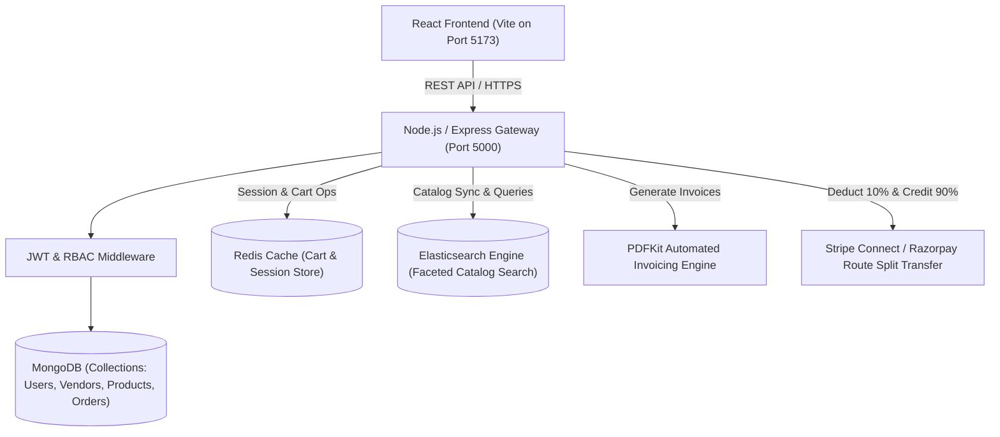

# MarketPulse — Multi-Vendor E-Commerce Marketplace

[](https://github.com/Amar209/Multi_vendor_e-commerce_marketplace/actions)
[](http://localhost:5000/api/docs)
[](docker-compose.yml)
[](package.json)
[](client/package.json)

> **Capstone Project Code:** FS-01 | **Track:** Full-Stack Development  
> An Amazon-style marketplace where many vendors sell, customers buy, and the platform splits payments and earns commission.

---

## 🌟 Key Architecture & Features

### 1. Multi-Vendor Role-Based Access Control (RBAC)
- **Customer**: Browse multi-vendor catalog, fuzzy search & filter, manage Redis-cached shopping cart, checkout with multi-vendor split payment, track order lifecycle (`placed` ➔ `packed` ➔ `shipped` ➔ `delivered`), and download PDF invoices.
- **Vendor**: Manage custom storefront, isolated product catalog CRUD, fulfill customer order items through the status stepper, and view a real-time earnings ledger (gross sales, 10% platform commission deduction, net payout balance).
- **Admin**: Platform-wide analytics dashboard monitoring Gross Merchandise Value (GMV), total platform commissions collected, vendor accounts, and product moderation.

### 2. Zero-Cost Technology Stack
- **Frontend**: React 19 + Vite + Custom Modern Glassmorphic Design System (Vanilla CSS + Lucide Icons + Canvas Confetti)
- **Backend API**: Node.js + Express REST API with security middleware (Helmet, CORS, Morgan)
- **Database**: MongoDB + Mongoose ODM (includes zero-setup in-memory database fallback)
- **Fast Cache**: Redis / In-Memory Redis Engine (sub-millisecond cart read/writes and session tracking)
- **Search Engine**: Elasticsearch Client with DSL query capability and faceted search adapter (fuzzy match, category & price range filters)
- **Payments**: Stripe Connect / Razorpay Route Test Mode Simulation (automated 10% platform commission fee deduction and simulated vendor payout transfers)
- **Invoicing**: Automated PDF Tax Invoices generated on-the-fly with `pdfkit`

---

## 🏗️ System Architecture



---

## 🚀 Quick Start (Zero Setup Required)

### 1. Start Backend Server
```bash
cd server
npm install
node src/server.js
```
*The server will start on `http://localhost:5000` with auto-seeded demo vendors, products, and admin accounts.*

### 2. Start Frontend App
```bash
cd client
npm install
npm run dev
```
*The React app will launch on `http://localhost:5173` with instant role switching.*

---

## 👥 Demo Pre-Seeded Accounts

| Role | Email | Password | Details |
| :--- | :--- | :--- | :--- |
| **Customer** | `customer@example.com` | `password123` | Alex Johnson (Has demo address & purchase history) |
| **Vendor 1** | `tech@vendor.com` | `password123` | TechHub Electronics (Audio, Wearables, Keyboards) |
| **Vendor 2** | `urban@vendor.com` | `password123` | Urban Vogue Studio (Fashion, Apparel, Leather Bags) |
| **Admin** | `admin@marketplace.com` | `password123` | Super Admin (Full platform revenue & GMV analytics) |

---

## 📡 REST API Documentation

### Authentication (`/api/auth`)
- `POST /api/auth/register` — Register customer or onboard vendor
- `POST /api/auth/login` — Authenticate and return JWT token
- `GET /api/auth/me` — Retrieve active authenticated user profile

### Catalog & Search (`/api/products`)
- `GET /api/products?q={query}&category={cat}&minPrice={min}&maxPrice={max}` — Elasticsearch / Database search
- `GET /api/products/:id` — Retrieve product details and vendor store info
- `POST /api/products` — Create new product listing (Vendor only)
- `PUT /api/products/:id` — Update existing product (Vendor only)
- `DELETE /api/products/:id` — Remove product listing (Vendor / Admin)
- `GET /api/products/vendor/mine` — List current vendor's inventory

### Shopping Cart (`/api/cart`)
- `GET /api/cart` — Fetch Redis-cached cart with latest hydrated prices & stock
- `POST /api/cart` — Add item to Redis cart
- `PUT /api/cart/:productId` — Update item quantity
- `DELETE /api/cart/:productId` — Remove item from cart
- `DELETE /api/cart` — Clear entire cart

### Orders & Split Payments (`/api/orders`)
- `POST /api/orders` — Checkout: Calculates 10% platform fee, credits 90% to vendors, empties Redis cart, and decrements inventory
- `GET /api/orders/my-orders` — Customer purchase history and delivery tracking
- `GET /api/orders/vendor/incoming` — Vendor view of items to fulfill
- `PUT /api/orders/:orderId/items/:itemId/status` — Fulfillment stepper (`placed` ➔ `packed` ➔ `shipped` ➔ `delivered`)
- `GET /api/orders/:id/invoice` — Download dynamic PDF tax invoice

### Platform Analytics (`/api/analytics`)
- `GET /api/analytics/admin` — Gross Merchandise Value (GMV), total commissions, vendor totals
- `GET /api/analytics/vendor` — Store gross sales, net balance, items sold

### Interactive OpenAPI / Swagger Documentation
- **Live Swagger UI**: `/api/docs` (Interactive API explorer to test all endpoints)
- **OpenAPI 3.0 Spec**: `/api/docs/spec.json`

---

## 🌐 Live External Deployment

| Service | Platform | Source Directory | Live Link |
| :--- | :--- | :--- | :--- |
| **Backend API** | [Render](https://render.com) | `/server` | `https://marketpulse-api.onrender.com` |
| **Frontend UI** | [Vercel](https://vercel.com) | `/client` | `https://marketpulse.vercel.app` |

See [DEPLOYMENT.md](DEPLOYMENT.md) for step-by-step production setup and environment variables.

---

## 📋 Evaluation Checklist & Deliverables

- [x] **Working Demo**: Multi-vendor marketplace running with verified customer, vendor, and admin flows.
- [x] **RBAC Authentication**: Secure JWT tokens with role verification.
- [x] **Elasticsearch Catalog Search**: Real-time fuzzy query filtering by category, brand, and pricing.
- [x] **Redis Cart Caching**: Sub-millisecond item operations and session persistence.
- [x] **Split Payments**: Automated platform commission deduction (10%) and vendor balance payout allocation.
- [x] **PDF Tax Invoices**: Dynamic on-the-fly invoice download for customers and vendors.
- [x] **Vendor Fulfillment & Admin Analytics**: Order lifecycle tracking and financial summaries.
- [x] **Zero-Cost Operation**: ₹0 expenditure, using local and sandbox test tools.
