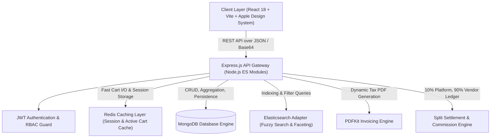

# System Architecture & API Specification
**MarketPulse — Multi-Vendor E-Commerce Marketplace**

---

## 1. High-Level Architectural Topology

---

## 2. Role-Based Access Control (RBAC) Matrix

| Resource / Capability | Customer | Vendor | Admin |
| :--- | :---: | :---: | :---: |
| Browse Catalog & Fuzzy Search | ✅ | ✅ | ✅ |
| Add to Redis-Cached Bag | ✅ | ❌ | ❌ |
| Multi-Method Checkout (Card, UPI, NetBanking, COD) | ✅ | ❌ | ❌ |
| Apply Promo Coupons (`WELCOME10`, `FESTIVE20`) | ✅ | ❌ | ❌ |
| Submit Verified Product Review & Rating | ✅ | ❌ | ❌ |
| Download Itemized PDF Tax Invoice | ✅ (Own Orders) | ✅ (Store Items) | ✅ (All Orders) |
| Vendor Onboarding & Store Registration | ❌ | ✅ | ✅ |
| Product Publishing (File Upload, Auto-Scaled Photos) | ❌ | ✅ | ✅ |
| Product Inventory Edit & Price Tuning | ❌ | ✅ (Own Products) | ✅ (All Products) |
| Order Fulfillment Pipeline (`placed` ➔ `packed` ➔ `shipped` ➔ `delivered`) | ❌ | ✅ (Own Store Items) | ✅ |
| Real-Time Store Sales Telemetry & Balance | ❌ | ✅ (Own Store) | ✅ |
| Platform-Wide Revenue, Commissions (10%) & Ledger | ❌ | ❌ | ✅ |
| Reset System to Clean State | ❌ | ✅ | ✅ |

---

## 3. Database Schema Models (Mongoose)

### 3.1 User (`User.js`)
- `_id`: ObjectId (Deterministic seeds for zero-downtime testing)
- `name`: String (Required)
- `email`: String (Unique, Indexed)
- `password`: String (Bcrypt hashed, `select: false`)
- `role`: Enum `['customer', 'vendor', 'admin']` (Default: `'customer'`)
- `avatar`: String
- `phone`: String
- `createdAt`, `updatedAt`: Timestamps

### 3.2 Vendor (`Vendor.js`)
- `_id`: ObjectId
- `user`: ObjectId ➔ `ref: 'User'` (Unique 1-to-1)
- `storeName`: String (Unique, Indexed)
- `slug`: String
- `description`: String
- `logo`: String
- `banner`: String
- `commissionRate`: Number (Default: `10` — 10% platform commission)
- `balance.available`: Number (Cleared vendor remittance in ₹)
- `balance.pending`: Number (Unsettled order volume)
- `totalSales`: Number (Lifetime gross sales)
- `isVerified`: Boolean (Default: `true`)

### 3.3 Product (`Product.js`)
- `_id`: ObjectId
- `vendor`: ObjectId ➔ `ref: 'Vendor'`
- `title`: String (Indexed)
- `slug`: String
- `description`: String
- `category`: Enum `['Electronics', 'Fashion', 'Footwear', 'Home & Living', 'Accessories']`
- `brand`: String
- `price`: Number (Retail price in ₹)
- `discountPrice`: Number (Optional sale price in ₹)
- `stock`: Number (Inventory units)
- `images`: Array of Strings (Base64 data or S3 URLs)
- `ratingAverage`: Number (1.0 to 5.0, Default: `5.0`)
- `numReviews`: Number (Default: `0`)
- `isPublished`: Boolean (Default: `true`)

### 3.4 Order (`Order.js`)
- `_id`: ObjectId
- `customer`: ObjectId ➔ `ref: 'User'`
- `orderNumber`: String (Unique, e.g. `ORD-1729700000-482`)
- `items`: Array of:
  - `product`: ObjectId ➔ `ref: 'Product'`
  - `vendor`: ObjectId ➔ `ref: 'Vendor'`
  - `title`: String
  - `image`: String
  - `price`: Number (Unit price in ₹)
  - `quantity`: Number
  - `vendorCommissionRate`: Number (10%)
  - `platformCommissionAmount`: Number (₹)
  - `vendorEarningAmount`: Number (90% remittance in ₹)
  - `vendorFulfillmentStatus`: Enum `['placed', 'packed', 'shipped', 'delivered', 'cancelled']`
- `shippingAddress`: Object (`street`, `city`, `state`, `postalCode`, `country`)
- `paymentInfo`:
  - `provider`: Enum `['card', 'upi', 'netbanking', 'stripe', 'razorpay', 'cod']`
  - `paymentIntentId`: String
  - `status`: Enum `['pending', 'paid', 'failed']`
- `subtotal`: Number
- `discount`: Number (Coupon savings in ₹)
- `couponCode`: String
- `tax`: Number (5% GST in ₹)
- `shippingFee`: Number (Free over ₹1,000, else ₹50)
- `commissionTotal`: Number (10% retained by platform in ₹)
- `totalAmount`: Number (Grand total billed to customer in ₹)
- `orderStatus`: Enum `['placed', 'packed', 'shipped', 'delivered', 'cancelled']`

### 3.5 Review (`Review.js`)
- `_id`: ObjectId
- `product`: ObjectId ➔ `ref: 'Product'`
- `customer`: ObjectId ➔ `ref: 'User'`
- `rating`: Number (1 to 5)
- `comment`: String
- `createdAt`, `updatedAt`: Timestamps

### 3.6 Coupon (`Coupon.js`)
- `_id`: ObjectId
- `code`: String (Uppercase, Unique, e.g., `WELCOME10`, `FESTIVE20`)
- `discountType`: Enum `['percentage', 'flat']`
- `discountValue`: Number (e.g. 10 for 10% or 500 for ₹500 flat)
- `minOrderAmount`: Number
- `maxDiscountAmount`: Number
- `isActive`: Boolean
- `expiryDate`: Date

---

## 4. RESTful API Directory

### Authentication (`/api/auth`)
- `POST /api/auth/register` — Register customer or vendor (with store profile)
- `POST /api/auth/login` — Sign in and issue JWT token
- `GET /api/auth/me` — Get authenticated user & profile
- `POST /api/auth/reset-clean` — Reset database to zero-state demo slate

### Catalog & Products (`/api/products`)
- `GET /api/products` — Search catalog with filters (`q`, `category`, `minPrice`, `maxPrice`, `sort`)
- `GET /api/products/:id` — Get product detail with seller profile
- `POST /api/products` — Create product listing (Vendor only)
- `PUT /api/products/:id` — Update listing price, stock, specs (Vendor only)
- `DELETE /api/products/:id` — Remove listing (Vendor/Admin)
- `GET /api/products/vendor/mine` — Get merchant's own listings

### Reviews & Ratings (`/api/products/:productId/reviews`)
- `GET /api/products/:productId/reviews` — Get all verified reviews for product
- `POST /api/products/:productId/reviews` — Post review and recalculate rating metrics

### Coupons & Promotions (`/api/coupons`)
- `GET /api/coupons` — List active public coupons
- `POST /api/coupons/validate` — Validate coupon code against subtotal and return savings
- `POST /api/coupons` — Create new promo code (Admin/Vendor)

### Redis Cart (`/api/cart`)
- `GET /api/cart` — Retrieve Redis-cached user cart
- `POST /api/cart` — Add item to cart
- `PUT /api/cart/:productId` — Update item quantity in cart
- `DELETE /api/cart/:productId` — Remove item from cart

### Orders & Invoices (`/api/orders`)
- `POST /api/orders` — Checkout, process split payment, decrement stock, clear Redis cart
- `GET /api/orders/my-orders` — List customer's placed orders
- `GET /api/orders/vendor/incoming` — List incoming orders requiring fulfillment by store
- `PUT /api/orders/:orderId/items/:itemId/status` — Advance item status (`packed` ➔ `shipped` ➔ `delivered`)
- `GET /api/orders/:id/invoice` — Generate and stream itemized PDF Tax Invoice

### Analytics & Telemetry (`/api/analytics`)
- `GET /api/analytics/admin` — GMV, commissions, vendor remittances, order history
- `GET /api/analytics/vendor` — Available cleared balance, gross volume, items sold
